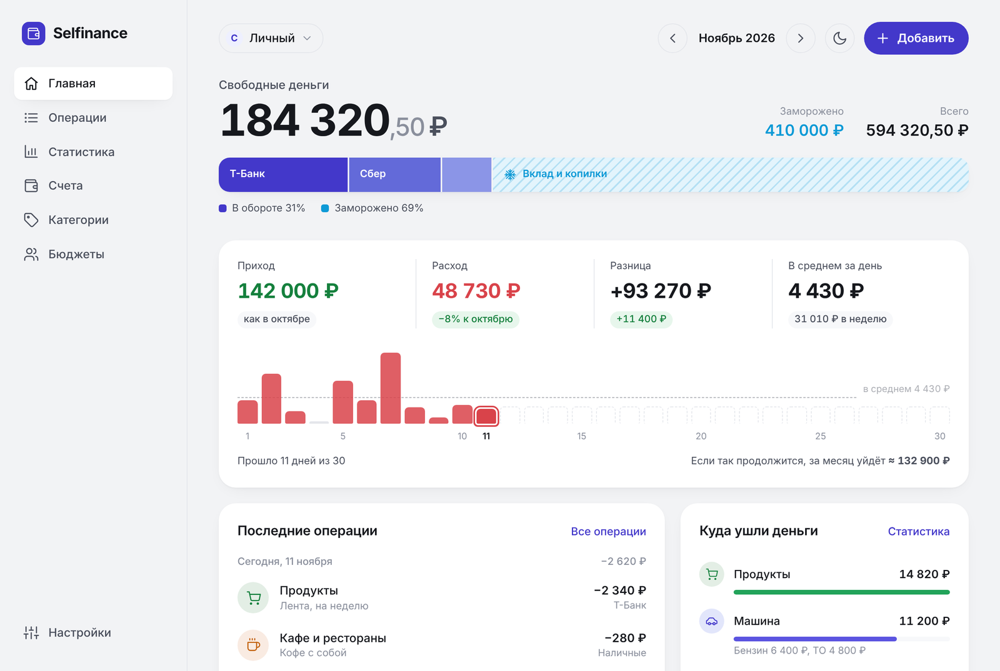

# Selfinance

[](https://github.com/kozhevyatov/selfinance/actions/workflows/docker.yml)

Простой учёт доходов и расходов, который работает на вашем собственном сервере: домашнем NAS, VPS или Raspberry Pi. Ставится одним `docker compose`, открывается в браузере и устанавливается на телефон как приложение (PWA).

Данные никуда не уходят: всё хранится у вас, в SQLite или в вашей MySQL/MariaDB.

<picture>
  <source media="(prefers-color-scheme: dark)" srcset="docs/screenshot-dark.png">
  
</picture>

## Возможности

- **Счета**: банковские карты, наличные, вклады, копилки. Переводы между счетами, сверка баланса.
- **Замороженные деньги**: накопления и вклады считаются отдельно от денег «в обороте», их можно разморозить.
- **Кредитки и кредиты**: у кредитной карты указывается лимит, на счёте видно «долг · доступно X из Y» и полоску использования лимита. Кредитные деньги не смешиваются со своими: долг вычитается из капитала, а доступный лимит показывается отдельной строкой «+ N ₽ доступно по кредиткам». Покупка с кредитки — обычный расход, погашение — перевод в одно нажатие. Кредиты и ипотека ведутся так же, только без лимита.
- **Операции**: доход, расход, перевод, корректировка. Сумму можно ввести выражением, например `350+120`.
- **Категории и подкатегории** с иконками и цветами. Если они не нужны, работает и как простой журнал «пришло / ушло».
- **Статистика** за месяц, год или любой период: доходы и расходы по дням, динамика за 12 месяцев, структура доходов и расходов, сравнение с прошлым периодом, средний расход в день и неделю.
- **Регулярные платежи**: напоминание на главной за несколько дней, период повторения (раз в месяц, раз в 3 месяца и т. д.).
- **Лимит расходов**: общий на месяц и по категориям, подсказка «можно тратить ≈ N ₽ в день», прогноз превышения. Обязательные платежи по умолчанию в лимит не входят.
- **Запланированные покупки**: заметка «через 10 дней купить резину за 30 000» висит на главной и показывает, хватает ли свободных денег к этой дате с учётом регулярных платежей. Дата необязательна — тогда это список желаний.
- **Несколько пользователей**: администратор, регистрация закрытая, по приглашениям или открытая. Вход по email или телефону.
- **PWA**: установка на телефон, ярлык «Добавить операцию», светлая и тёмная темы.
- **REST API**: на нём же будут работать будущие мобильные приложения.

## Установка

Нужен только Docker с Compose. Готовые образы собираются для `amd64` и `arm64`.

Выберите один из трёх вариантов: создайте пустую папку, положите в неё `docker-compose.yml` из примера и выполните `docker compose up -d`. Потом откройте `http://<адрес-сервера>:1444`.

### Вариант 1. SQLite: проще всего

Подходит для себя и для семьи. Вся база хранится в одном файле `data/selfinance.db`.

```yaml
services:
  selfinance:
    image: ghcr.io/kozhevyatov/selfinance:latest
    container_name: selfinance
    restart: unless-stopped
    ports:
      - "1444:1444"
    volumes:
      - ./data:/data
    environment:
      - TZ=Europe/Moscow
```

Или одной командой:

```bash
mkdir selfinance && cd selfinance
curl -o docker-compose.yml https://raw.githubusercontent.com/kozhevyatov/selfinance/main/examples/docker-compose.sqlite.yml
docker compose up -d
```

В мастере настройки выберите **SQLite**.

### Вариант 2. Уже есть MySQL или MariaDB

Если база работает в другом контейнере на этом же сервере, подключите оба контейнера к одной Docker-сети:

```bash
docker network create db                    # если сети ещё нет
docker network connect db <контейнер_базы>
```

```yaml
services:
  selfinance:
    image: ghcr.io/kozhevyatov/selfinance:latest
    container_name: selfinance
    restart: unless-stopped
    ports:
      - "1444:1444"
    volumes:
      - ./data:/data
    environment:
      - TZ=Europe/Moscow
    networks:
      - default
      - db

networks:
  db:
    external: true
```

В мастере настройки выберите **MySQL/MariaDB**. В поле хоста укажите имя контейнера базы, а также пользователя, пароль и имя базы. Если базы с таким именем нет, Selfinance создаст её сам (нужны права на `CREATE DATABASE`).

Если база стоит на другом сервере, блоки `networks` не нужны: в мастере укажите IP или домен этого сервера. Полный пример с комментариями лежит в [`examples/docker-compose.external-db.yml`](examples/docker-compose.external-db.yml).

### Вариант 3. Selfinance вместе со своей MariaDB

Сервис и база поднимаются одним файлом. Сначала создайте рядом файл `.env` с паролями:

```env
DB_PASSWORD=придумайте_пароль
DB_ROOT_PASSWORD=придумайте_другой_пароль
```

```yaml
services:
  selfinance:
    image: ghcr.io/kozhevyatov/selfinance:latest
    container_name: selfinance
    restart: unless-stopped
    ports:
      - "1444:1444"
    volumes:
      - ./data:/data
    environment:
      - TZ=Europe/Moscow
    depends_on:
      mariadb:
        condition: service_healthy

  mariadb:
    image: mariadb:11
    container_name: selfinance-mariadb
    restart: unless-stopped
    environment:
      - MARIADB_ROOT_PASSWORD=${DB_ROOT_PASSWORD:?Укажите DB_ROOT_PASSWORD в .env}
      - MARIADB_DATABASE=selfinance
      - MARIADB_USER=selfinance
      - MARIADB_PASSWORD=${DB_PASSWORD:?Укажите DB_PASSWORD в .env}
      - TZ=Europe/Moscow
    volumes:
      - ./mariadb:/var/lib/mysql
    healthcheck:
      test: ["CMD", "healthcheck.sh", "--connect", "--innodb_initialized"]
      interval: 10s
      timeout: 5s
      retries: 10
```

В мастере настройки выберите **MySQL/MariaDB**:

| Поле | Значение |
|---|---|
| Хост | `mariadb` |
| Порт | `3306` |
| Пользователь | `selfinance` |
| Пароль | значение `DB_PASSWORD` из `.env` |
| База | `selfinance` |

Файл примера: [`examples/docker-compose.mariadb.yml`](examples/docker-compose.mariadb.yml).

## Первый запуск

При первом открытии появится мастер настройки:

1. Выбор базы данных: SQLite или MySQL/MariaDB.
2. Создание администратора: имя, email или телефон, пароль.
3. Режим регистрации: закрытая, по приглашениям или открытая.

Настройки подключения и секретный ключ сохраняются в `data/config.json`. Если подключить базу, в которой уже есть пользователи, Selfinance просто продолжит работать с ней.

## Настройки контейнера

| Параметр | Где | По умолчанию | Описание |
|---|---|---|---|
| Порт | `ports` | `1444` | Левая часть: порт на сервере, например `"8080:1444"` |
| `TZ` | `environment` | `Europe/Moscow` | Часовой пояс сервера |
| `/data` | `volumes` | `./data` | Папка с конфигом и базой SQLite |

## Обновление

```bash
docker compose pull
docker compose up -d
```

Миграции базы выполняются автоматически при запуске.

## Резервная копия

Сохраняйте папку `data/`: в ней `config.json` и, если вы выбрали SQLite, файл базы `selfinance.db`. Для MySQL/MariaDB дополнительно делайте дамп базы, например:

```bash
docker exec selfinance-mariadb mariadb-dump -u root -p selfinance > selfinance.sql
```

## HTTPS и установка на телефон

PWA (установка на главный экран) работает только по HTTPS. Поставьте перед Selfinance любой обратный прокси с сертификатом, например Nginx Proxy Manager, Caddy или Traefik, и направьте его на порт `1444`.

## Сборка из исходников

```bash
git clone https://github.com/kozhevyatov/selfinance.git
cd selfinance
docker compose up -d --build
```

## Разработка

```
selfinance/
├── app/                 код приложения (npm workspaces)
│   ├── Dockerfile
│   ├── apps/api         бэкенд: Fastify + Kysely (SQLite / MySQL / MariaDB)
│   ├── apps/web         фронтенд: React + Vite
│   └── packages/shared  общие типы, схемы (zod), форматирование денег и дат
├── examples/            примеры docker-compose
├── docs/                скриншоты для README
├── data/                данные (в git не попадают)
└── SPEC.md              спецификация
```

```bash
cd app
npm install
npm run dev:api     # API на :1444, данные в ../data
npm run dev:web     # Vite на :5173, проксирует /api на :1444
```

### API

- Все маршруты находятся под `/api/v1`. Проверка работы: `GET /api/health`.
- Авторизация: `Authorization: Bearer <accessToken>`. Access-токен живёт 15 минут, refresh-токен — 30 дней, обновление через `POST /api/v1/auth/refresh`.
- Суммы передаются в копейках (целые числа), даты — в формате `YYYY-MM-DD`.

## Планы

- Общие (семейные) бюджеты.
- Мобильные приложения для Android и iOS.
